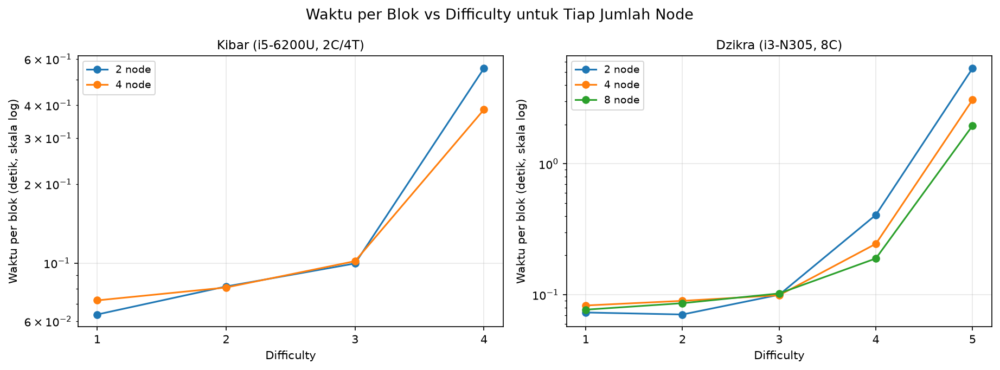
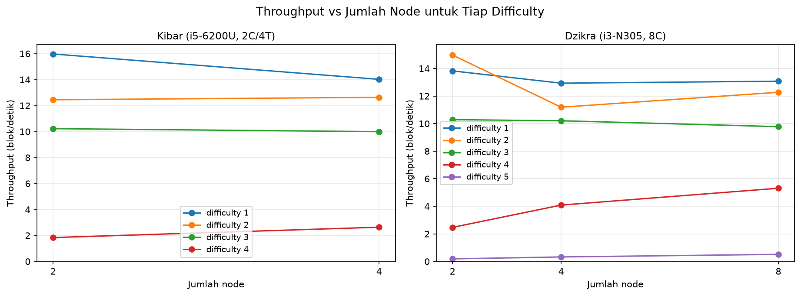
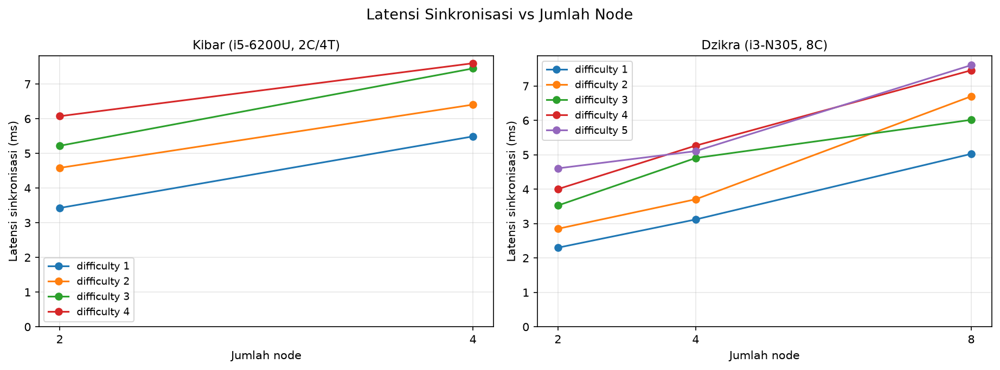
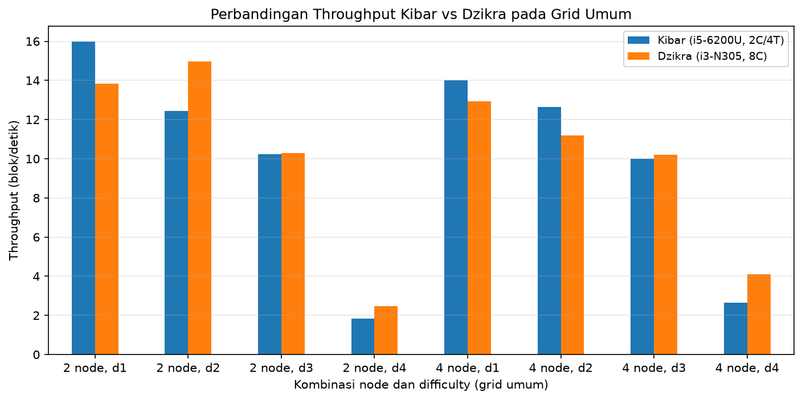
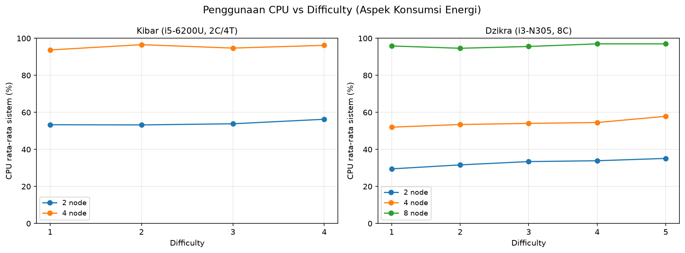

# BAB 5 — HASIL DAN ANALISIS

> **Penulis bagian ini:** Dzikra
>
> ⚠️ **STATUS DATA — BACA DULU.** Tabel grid pada Bagian 5.3–5.8 masih memakai **data simulasi awal (dummy)** yang dihasilkan `analysis/make_dummy.py`, bukan hasil pengukuran benchmark. Tujuannya agar struktur tabel, grafik, dan alur analisis sudah siap sebelum `bench/run_experiments.py` selesai dikerjakan. Seluruh angka pada tabel grid **wajib diganti** dengan CSV asli `results/raw/dzikra_*.csv` dan `results/raw/kibar_*.csv` sebelum laporan dikumpulkan. **Pengecualian:** Bagian 5.9 adalah pengukuran asli hash rate dan waktu mining di laptop Dzikra, bukan dummy. Kesimpulan pada Bab 6 tetap tidak boleh diambil dari angka grid dummy.

## 5.1 Konfigurasi Eksperimen

### 5.1.1 Perangkat

| | Kibar | Dzikra |
|---|---|---|
| CPU | Intel i5-6200U @2,3 GHz (2 core/4 thread, 2016) | Intel i3-N305 @1,8 GHz (8 core) |
| RAM | 8 GB | 8 GB |
| OS | Windows 10 Pro 22H2 | Windows 11 25H2 |
| GPU | Tanpa GPU diskrit | Tanpa GPU diskrit |
| Peran | Patokan terendah | Demo dan uji skala besar |

### 5.1.2 Grid Eksperimen

| Grid | Node | Difficulty | Blok | Mesin |
|---|---|---|---|---|
| Umum | 2, 4 | 1, 2, 3, 4 | 10 | Kibar + Dzikra |
| Tambahan | 8 | 1, 2, 3, 4 | 10 | Dzikra |
| Tambahan | 2, 4, 8 | 5 | 10 | Dzikra |

Setiap kombinasi diulang **3 kali**. Total data simulasi awal: 23 kombinasi `(machine, nodes, difficulty)` atau 69 baris run.

### 5.1.3 Prosedur

Pada benchmark asli, setiap run menjalankan N proses node, menunggu hingga seluruh node mencapai `blocks_target`, mengumpulkan event JSONL, lalu menghitung metrik. Charger tercolok, power mode “Best performance”, dan aplikasi berat ditutup. Jeda 2–3 detik diberikan antar-run untuk pelepasan port dan pendinginan CPU.

Pada data dummy, prosedur tersebut dimodelkan secara analitis: waktu blok mengikuti ekspektasi `16^difficulty` hash, hash power bertambah sublinear terhadap jumlah node (`nodes^0.85`), dan ditambahkan overhead proses. Karena itu angka di bawah **tidak boleh** dikutip sebagai hasil pengukuran.

## 5.2 Metode Pengolahan Data

Seluruh CSV di `results/dummy/` (atau `results/raw/` untuk data asli) digabungkan dengan `pandas`. Untuk setiap `(machine, nodes, difficulty)` dihitung rata-rata dan standar deviasi dari tiga ulangan. Hasilnya disimpan di `results/summary.csv`. Grafik dibuat oleh `analysis/analyze.py` dengan judul dan label Bahasa Indonesia.

Metrik yang dianalisis:

- `throughput_bps` — blok terkonfirmasi per detik;
- `avg_block_time_s` — total waktu dibagi blok terkonfirmasi;
- `avg_sync_latency_ms` — rata-rata selisih waktu terima dan `sent_at`;
- `forks_detected` dan `orphan_blocks` — indikator ketidakstabilan rantai;
- `cpu_avg_pct` — penggunaan CPU sistem rata-rata;
- `cpu_seconds_proxy` — turunan `cpu_avg_pct/100 x total_time_s` sebagai proksi energi.

## 5.3 Hasil Grid Umum

### 5.3.1 Throughput, Waktu per Blok, dan Latensi

Nilai berikut adalah rata-rata 3 ulangan data simulasi awal. Notasi `d` menyatakan difficulty.

| Mesin | Node | d | Throughput (blok/dtk) | Waktu/blok (dtk) | Latensi (ms) |
|---|---:|---:|---:|---:|---:|
| Kibar | 2 | 1 | 15,97 ± 2,48 | 0,064 | 3,43 |
| Kibar | 2 | 2 | 12,45 ± 1,77 | 0,081 | 4,58 |
| Kibar | 2 | 3 | 10,22 ± 1,74 | 0,100 | 5,22 |
| Kibar | 2 | 4 | 1,84 ± 0,29 | 0,553 | 6,07 |
| Kibar | 4 | 1 | 14,02 ± 1,70 | 0,072 | 5,49 |
| Kibar | 4 | 2 | 12,64 ± 2,18 | 0,081 | 6,41 |
| Kibar | 4 | 3 | 9,99 ± 1,53 | 0,102 | 7,45 |
| Kibar | 4 | 4 | 2,64 ± 0,42 | 0,385 | 7,60 |
| Dzikra | 2 | 1 | 13,83 ± 1,89 | 0,073 | 2,30 |
| Dzikra | 2 | 2 | 14,98 ± 3,98 | 0,071 | 2,85 |
| Dzikra | 2 | 3 | 10,29 ± 2,20 | 0,100 | 3,53 |
| Dzikra | 2 | 4 | 2,47 ± 0,23 | 0,407 | 4,00 |
| Dzikra | 4 | 1 | 12,93 ± 4,39 | 0,083 | 3,12 |
| Dzikra | 4 | 2 | 11,19 ± 0,99 | 0,090 | 3,71 |
| Dzikra | 4 | 3 | 10,21 ± 1,36 | 0,099 | 4,91 |
| Dzikra | 4 | 4 | 4,09 ± 0,15 | 0,245 | 5,27 |

Terlihat pola yang konsisten: difficulty 1–3 didominasi overhead sehingga throughput relatif datar (9–16 blok/detik), sedangkan difficulty 4 mulai didominasi mining sehingga throughput turun tajam. Penurunan paling drastis terjadi pada difficulty 5 (Tabel 5.2), ketika waktu blok mencapai beberapa detik.

### 5.3.2 Grid Tambahan Dzikra (8 Node dan Difficulty 5)

| Node | d | Throughput (blok/dtk) | Waktu/blok (dtk) | Latensi (ms) | Fork | Orphan | CPU (%) |
|---:|---:|---:|---:|---:|---:|---:|---:|
| 2 | 5 | 0,187 | 5,361 | 4,61 | 0,33 | 0,33 | 35,13 |
| 4 | 5 | 0,326 | 3,080 | 5,11 | 1,00 | 0,67 | 57,87 |
| 8 | 5 | 0,513 | 1,955 | 7,61 | 1,33 | 0,67 | 97,00 |
| 8 | 1 | 13,077 | 0,077 | 5,03 | 8,67 | 3,67 | 95,87 |
| 8 | 2 | 12,274 | 0,086 | 6,70 | 4,33 | 3,67 | 94,62 |
| 8 | 3 | 9,780 | 0,102 | 6,02 | 3,33 | 2,67 | 95,59 |
| 8 | 4 | 5,312 | 0,189 | 7,46 | 1,67 | 1,33 | 97,00 |

Pada difficulty 5, penambahan node dari 2 ke 8 meningkatkan throughput sekitar **2,75 kali** (0,187 → 0,513 blok/detik). Ini menunjukkan bahwa ketika mining menjadi bottleneck, penambahan hash power benar-benar bermanfaat. Sebaliknya pada difficulty 1–3, penambahan node tidak menaikkan throughput karena waktu didominasi startup dan sinkronisasi.

### 5.3.3 Fork dan Blok Orphan

| Mesin | Node | Fork (d1) | Fork (d3) | Fork (d5) | Orphan (d1) |
|---|---:|---:|---:|---:|---:|
| Kibar | 2 | 2,00 | 0,33 | — | 1,33 |
| Kibar | 4 | 4,00 | 1,33 | — | 2,33 |
| Dzikra | 2 | 1,33 | 1,00 | 0,33 | 0,67 |
| Dzikra | 4 | 6,33 | 2,00 | 1,00 | 4,67 |
| Dzikra | 8 | 8,67 | 3,33 | 1,33 | 3,67 |

Dua pola muncul. Pertama, fork meningkat tajam seiring jumlah node: pada difficulty 1, 8 node menghasilkan rata-rata 8,67 fork per run dibanding 1,33 pada 2 node. Kedua, fork menurun seiring difficulty karena interval blok memanjang dan peluang dua node menemukan blok bersamaan mengecil. Blok orphan mengikuti pola fork dengan proporsi sekitar 40–70%.

## 5.4 Pengaruh Difficulty

Gambar 5.1 menunjukkan waktu per blok terhadap difficulty. Skala log dipakai pada panel Dzikra karena rentangnya melewati dua orde magnitudo. Bentuk kurva mendekati linear pada skala log untuk difficulty 3–5, yang konsisten dengan ekspektasi PoW: setiap kenaikan difficulty menggandakan empat bit target, sehingga pekerjaan naik 16 kali lipat. Pada difficulty 1–2 kurva mendatar karena waktu blok didominasi overhead proses dan sinkronisasi, bukan hashing.

Implikasi praktisnya: **kenaikan difficulty baru terasa setelah biaya mining melampaui biaya tetap (overhead)**. Pada simulasi ini ambang tersebut berada di sekitar difficulty 3–4.

## 5.5 Pengaruh Jumlah Node

Gambar 5.2 memperlihatkan bahwa pengaruh jumlah node bergantung pada difficulty:

- **Difficulty 1–3:** throughput relatif datar atau sedikit menurun saat node ditambah. Pekerjaan mining sangat singkat sehingga overhead per proses dan sinkronisasi mendominasi. Menambah node hanya menambah biaya koordinasi.
- **Difficulty 4:** throughput Dzikra naik dari 2,47 (2 node) menjadi 4,09 (4 node) dan 5,31 (8 node), sekitar 1,7–2,1 kali.
- **Difficulty 5:** throughput naik dari 0,187 (2 node) menjadi 0,513 (8 node), sekitar 2,75 kali. Namun kenaikannya tetap sublinear karena perebutan core dan bertambahnya fork.

Hasil ini menggambarkan *diminishing returns* dari skalabilitas horizontal: penambahan node memberi manfaat terbesar ketika beban komputasi per blok tinggi, tetapi tidak menghilangkan biaya koordinasi.

## 5.6 Latensi Sinkronisasi

Latensi pada simulasi localhost berada pada rentang **2–8 ms**. Nilainya meningkat seiring jumlah node karena lebih banyak thread penanganan koneksi dan proses yang berebut CPU, serta karena setiap blok harus divalidasi dan dicatat ke log. Difficulty juga menaikkan latensi secara ringan, kemungkinan karena CPU lebih sibuk saat mining berlangsung.

Meskipun kecil secara absolut, latensi ini penting secara relatif: pada difficulty 1, waktu blok hanya sekitar 70 ms, sehingga latensi 5 ms setara sekitar 7% interval blok. Pada difficulty 5, waktu blok beberapa detik sehingga latensi menjadi tidak signifikan. Artinya, **semakin cepat rantai berproduksi, semakin besar porsi waktu yang dipakai untuk koordinasi**.

## 5.7 Perbandingan Kibar vs Dzikra

| Node | d | Throughput Kibar | Throughput Dzikra | Rasio Dzikra/Kibar |
|---:|---:|---:|---:|---:|
| 2 | 1 | 15,97 | 13,83 | 0,87 |
| 2 | 2 | 12,45 | 14,98 | 1,20 |
| 2 | 3 | 10,22 | 10,29 | 1,01 |
| 2 | 4 | 1,84 | 2,47 | 1,35 |
| 4 | 1 | 14,02 | 12,93 | 0,92 |
| 4 | 2 | 12,64 | 11,19 | 0,89 |
| 4 | 3 | 9,99 | 10,21 | 1,02 |
| 4 | 4 | 2,64 | 4,09 | 1,55 |

Perbedaan perangkat keras paling terasa pada difficulty tinggi: pada difficulty 4 dengan 4 node, Dzikra sekitar 1,55 kali lebih cepat. Pada difficulty 1–3, rasio mendekati 1 atau bahkan di bawah 1 karena hasil didominasi overhead dan noise, bukan kekuatan CPU. Temuan ini masuk akal: i3-N305 memiliki 8 core sehingga lebih tahan terhadap perebutan CPU, sedangkan i5-6200U hanya punya 2 core/4 thread dan harus menjalankan 4 proses mining sekaligus.

Perlu dicatat bahwa pada data dummy ini rasio di bawah 1 sepenuhnya artefak model dan variasi acak. Pada data asli, perbedaan bisa lebih jelas atau lebih kecil tergantung kondisi termal dan throttling.

## 5.8 Penggunaan CPU dan Energi

| Mesin | Node | CPU d1 (%) | CPU d5 (%) | CPU-detik d1 | CPU-detik d5 |
|---|---:|---:|---:|---:|---:|
| Kibar | 2 | 53,32 | — | 0,34 | — |
| Kibar | 4 | 93,72 | — | 0,68 | — |
| Dzikra | 2 | 29,48 | 35,13 | 0,22 | 18,83 |
| Dzikra | 4 | 52,01 | 57,87 | 0,43 | 17,82 |
| Dzikra | 8 | 95,87 | 97,00 | 0,74 | 18,97 |

Penggunaan CPU lebih ditentukan oleh **jumlah node** daripada difficulty. Satu node yang mining memakai sekitar satu core secara terus-menerus, sehingga persentase CPU sistem mengikuti rasio node terhadap jumlah thread logis. Difficulty hanya menambah sedikit beban karena loop hash tetap berjalan; yang berubah adalah lamanya loop tersebut berlangsung.

Proksi CPU-detik memberi wawasan penting. Pada difficulty 5, CPU-detik untuk 2, 4, dan 8 node hampir sama (18,83; 17,82; 18,97). Artinya, **total kerja komputasi untuk 10 blok pada difficulty 5 relatif tetap**, sedangkan penambahan node mempersingkat wall-clock. Konsekuensinya, daya rata-rata yang ditarik naik ketika lebih banyak core aktif bersamaan, meskipun durasi run lebih pendek. Pada difficulty rendah, CPU-detik justru meningkat seiring node tanpa diikuti kenaikan throughput, sehingga penambahan node pada beban rendah tidak efisien secara energi.

Angka ini adalah proksi, bukan pengukuran watt. Untuk klaim energi yang lebih kuat diperlukan pengukuran daya listrik eksternal atau pembacaan sensor daya CPU.

## 5.9 Pengukuran Tambahan: Hash Rate dan Throttling (Data Asli)

> Bagian ini **bukan data dummy**. Pengukuran dilakukan pada 25 November 2026 di laptop Dzikra (Intel i3-N305, Windows 11, Python 3.15.2) memakai `analysis/microbench_core.py`, satu proses, tanpa proses mining lain. Charger dan power mode tidak diverifikasi ulang pada sesi ini, sehingga angka bersifat indikatif untuk mesin tersebut.

### 5.9.1 Laju Hash Mentah dan Berkelanjutan

| Pengukuran | Hash/detik |
|---|---:|
| Hash mentah jendela pendek (20.000 hash) | 121.790 |
| Berkelanjutan jendela 1 (200.000 hash) | 112.372 |
| Berkelanjutan jendela 2 | 76.108 |
| Berkelanjutan jendela 3 | 52.466 |
| Berkelanjutan jendela 4 | 52.907 |
| Berkelanjutan jendela 5 | 52.022 |

Laju hash turun sekitar **57%** dari kondisi awal ke kondisi stabil, dan bertahan di sekitar **52.000 hash/detik** setelah dua jendela. Pola ini konsisten dengan penurunan frekuensi CPU akibat beban penuh berkelanjutan (*throttling* termal/daya) pada prosesor kelas rendah daya. Implikasinya penting: benchmark dengan durasi puluhan detik tidak boleh memakai angka hash rate jendela pendek; yang relevan adalah laju stabil.

### 5.9.2 Waktu Mining per Difficulty

Diukur setelah CPU berada pada kondisi stabil (tiga sampel per difficulty):

| d | Waktu mining (s) | Std (s) | Attempts rata-rata | Teori 16^d | Attempts/detik | Verifikasi (µs) |
|---:|---:|---:|---:|---:|---:|---:|
| 1 | 0,0004 | 0,0001 | 20 | 16 | 47.161 | 19,55 |
| 2 | 0,0037 | 0,0047 | 160 | 256 | 44.740 | 20,11 |
| 3 | 0,0722 | 0,0699 | 3.435 | 4.096 | 45.789 | 31,23 |
| 4 | 0,9431 | 0,4167 | 47.156 | 65.536 | 50.298 | 19,56 |
| 5 | 17.7495 | 9,7777 | 903.056 | 1.048.576 | 51.089 | 20,42 |

Data mentah: `results/microbench/dzikra_microbench_20261125_175634.csv` dan `results/microbench/dzikra_microbench_sustained_20261125_175634.csv`.

Temuan:

1. **Difficulty 3 hanya sekitar 0,07 detik** pada kondisi throttled, jauh di bawah batas 2 detik yang ditargetkan. Pada kondisi burst, nilainya sekitar 0,03 detik.
2. **Difficulty 4 memerlukan sekitar 0,94 detik**, dan **difficulty 5 sekitar 17,7 detik** untuk satu blok di satu proses. Ini menegaskan bahwa d5 adalah bottleneck utama eksperimen.
3. **Standar deviasi d5 mencapai 55% dari rata-rata.** Nilai ini wajar karena jumlah percobaan mengikuti distribusi geometrik; satu blok bisa selesai jauh lebih cepat atau lebih lambat. Pengukuran satu blok tidak dapat diandalkan; harus dirata-ratakan.
4. **Waktu verifikasi hanya sekitar 20 mikrodetik**, sekitar lima orde magnitudo lebih murah daripada mining d5. Ini mendukung asumsi bahwa validasi blok di jaringan bukan bottleneck; mining yang mendominasi.

### 5.9.3 Implikasi untuk Benchmark Jaringan

Dengan laju stabil sekitar 52.000 hash/detik per proses:

- **d5 dengan 2 node:** total ~104.000 hash/detik, satu blok butuh rata-rata ~10 detik, sehingga 10 blok memerlukan sekitar **100 detik**. Ini sangat dekat dengan timeout 120 detik yang disarankan pada kontrak.
- **d5 dengan 4 node:** sekitar 50 detik; **d5 dengan 8 node:** sekitar 25 detik.
- Karena variansi geometrik, peluang total waktu melewati 120 detik pada d5 2 node tidak dapat diabaikan.

Saran untuk runner benchmark: gunakan **timeout minimal 180 detik khusus d5**, jalankan d5 paling akhir, dan beri jeda 5–10 detik antar-run agar CPU sempat turun suhu. Tanpa itu, sebagian run d5 berisiko dicatat sebagai timeout padahal hanya lambat.

## 5.10 Pembahasan

Tiga temuan utama dari data simulasi awal:

1. **Efek difficulty bersifat ambang.** Selama biaya mining masih di bawah overhead, kenaikan difficulty tidak banyak mengubah throughput. Setelah ambang terlampaui, setiap tingkat difficulty menaikkan waktu blok mendekati 16 kali lipat, sesuai teori.
2. **Skalabilitas node bergantung pada beban.** Menambah node bermanfaat pada difficulty tinggi (hingga sekitar 2,75 kali pada d5), tetapi tidak efektif pada difficulty rendah. Ini adalah manifestasi konkret dari hukum Amdahl pada sistem terdistribusi: bagian serial dan overhead koordinasi membatasi percepatan.
3. **Ada trade-off antara throughput dan stabilitas rantai.** Konfigurasi dengan banyak node dan difficulty rendah menghasilkan throughput tinggi tetapi juga fork dan orphan terbanyak. Konfigurasi dengan difficulty tinggi lebih stabil tetapi jauh lebih lambat dan menuntut CPU lebih lama.

Untuk pemakaian nyata, konfigurasi yang seimbang bukan yang throughput-nya paling tinggi, melainkan yang mampu mempertahankan laju blok cukup tinggi tanpa fork berlebihan. Pada simulasi ini, difficulty 3 dengan 4 node memberi titik tengah yang menarik: throughput masih sekitar 10 blok/detik, latensi di bawah 8 ms, dan fork sekitar 1–2 per run.

## 5.11 Keterbatasan dan Validitas

1. **Tabel grid masih dummy.** Angka pada Bagian 5.3–5.8 berasal dari model `make_dummy.py`, bukan pengukuran. Bagian 5.9 sudah asli, tetapi hanya mengukur core di satu proses, bukan jaringan multi-node.
2. **Satu mesin, localhost.** Tidak ada latensi jaringan nyata, packet loss, atau perbedaan jam antar-mesin.
3. **Jumlah blok per run kecil (10).** Variasi acak mining cukup besar, sehingga standar deviasi beberapa metrik mencapai 20–30% dari rata-rata.
4. **Tiga ulangan.** Cukup untuk melihat tren, tetapi belum memadai untuk uji statistik yang kuat.
5. **Tidak ada pengukuran daya listrik.** Pembahasan energi hanya memakai proksi CPU-detik.
6. **Node berbagi CPU.** Penambahan node di satu laptop tidak setara dengan penambahan mesin fisik; perebutan core dan cache memengaruhi hasil.
7. **Pengukuran microbenchmark belum dibandingkan dengan Kibar.** Angka 5.9 baru berasal dari laptop Dzikra dan belum menyertakan catatan charger/power mode.

## 5.12 Rencana Pembaruan

Setelah `bench/run_experiments.py` tersedia dan benchmark dijalankan di kedua laptop:

1. Ganti `--raw-dir results/dummy` menjadi `results/raw`.
2. Jalankan `python -m analysis.analyze --raw-dir results/raw`.
3. Perbarui Tabel 5.1–5.4 dan Gambar 5.1–5.6 dengan angka asli.
4. Hapus banner status data dan kalimat yang menyebut data simulasi **hanya untuk tabel grid**; Bagian 5.9 tetap dipertahankan sebagai pengukuran asli.
5. Bandingkan hasil asli dengan ekspektasi teoretis pada Bab 2, lalu perbarui Bab 6 (kesimpulan) bersama Kibar.
6. Jalankan `analysis/microbench_core.py` di laptop Kibar untuk melengkapi perbandingan hardware pada Bagian 5.9.

Sampai langkah tersebut selesai, bab ini berstatus **draf metode dan kerangka analisis**, bukan hasil penelitian final.
